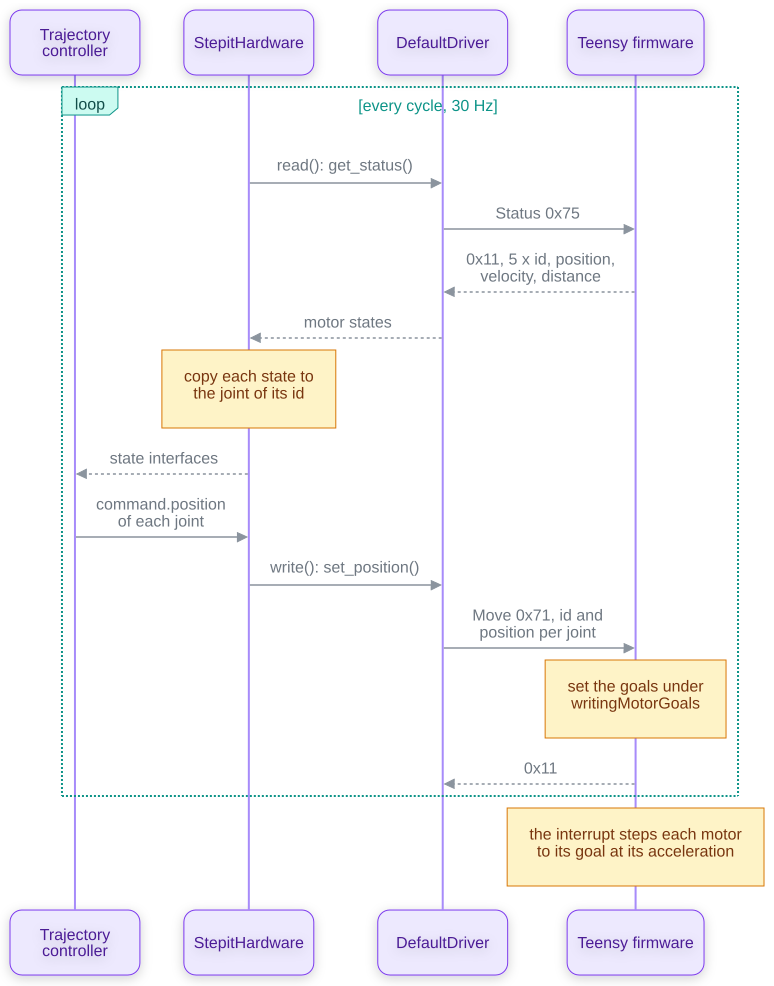

# StepIt Motors Architecture

## Table of Contents <!-- omit in toc -->

- [Introduction](#introduction)
- [The Big Picture](#the-big-picture)
- [The Packages](#the-packages)
- [The Hardware Interface](#the-hardware-interface)
  - [The Lifecycle](#the-lifecycle)
  - [Read and Write](#read-and-write)
  - [Switching Controllers](#switching-controllers)
  - [The Status](#the-status)
- [The Drivers](#the-drivers)
  - [Driver and the Factory](#driver-and-the-factory)
  - [DefaultDriver](#defaultdriver)
  - [FakeDriver and FakeMotor](#fakedriver-and-fakemotor)
- [The Protocol](#the-protocol)
  - [Commands](#commands)
  - [The Handshake and the Version](#the-handshake-and-the-version)
- [The Firmware](#the-firmware)
  - [The Interrupt and the Main Loop](#the-interrupt-and-the-main-loop)
  - [Position and Velocity Goals](#position-and-velocity-goals)
  - [What the Firmware Rejects](#what-the-firmware-rejects)
- [A Move from a Controller](#a-move-from-a-controller)
- [Safety Nets](#safety-nets)
- [Tests](#tests)
- [How to Extend the Driver](#how-to-extend-the-driver)
- [Design Decisions and Trade-offs](#design-decisions-and-trade-offs)

## Introduction

This document explains how StepIt Motors is built: the `ros2_control` hardware interface, the drivers behind it, the protocol over the serial port and the firmware of the Teensy, what each part is responsible for, and why it is built that way. It describes the code as it is, firmware 1.1.1, protocol version 1. It assumes we have read the [README](../README.md). The design notes of past changes are in [docs/design](design).

It follows one idea: **`StepitHardware` talks to the motors only through the `Driver` interface**, so the real controller and the fake motors are interchangeable. The hardware interface never opens a port or computes a motion: it turns the joints of `ros2_control` into driver calls, and the driver decides whether they reach a Teensy over USB or a model of a stepper motor in memory.

## The Big Picture

The robot is up to five stepper motors, each driven by a TMC2208 on a PiBot board, whose step, direction and enable pins a Teensy 4.x drives. The Teensy runs [AccelStepper](https://www.airspayce.com/mikem/arduino/AccelStepper/) on a timer interrupt and answers the host over USB. On the host, `ros2_control_node` loads `StepitHardware` as a plugin, and the controllers write the joints' commands into it.

<!-- The source is diagrams/big-picture.mmd: change it, then run bin/render-diagrams.sh. -->
<p align="center"></p>

The interface of the module:

| Name | Type | What it does |
|---|---|---|
| `stepit_driver/StepitHardware` | `ros2_control` system plugin | The hardware, named `motors` in [`stepit.urdf.xacro`](../src/robot_description/urdf/stepit.urdf.xacro). |
| `joint1` to `joint5`, `position` and `velocity` | command interfaces | The target of each joint, in rad or rad/s. A joint follows whichever one an active controller claims. |
| `joint1` to `joint5`, `position` and `velocity` | state interfaces | Where each motor is and how fast it turns, as the controller reports it. |
| `/motors/status` | `stepit_motors_msgs/msg/MotorsStatus` topic | Whether the hardware talks to the controller, the serial port or `fake`, and why not. Latched, on a change and every second. |
| `joint_state_broadcaster` | controller, active | Publishes `/joint_states`. |
| `joint_trajectory_controller` | controller, active | Follows a `JointTrajectory` on the `position` interfaces. |
| `position_controller`, `velocity_controller` | controllers, inactive | Forward a `Float64MultiArray` of positions or velocities on `/<controller>/commands` once activated. |
| `use_dummy` | launch argument, `true` | The fake motors, or the Teensy on `usb_port`. |
| `usb_port` | launch argument, `/dev/ttyACM0` | The serial port of the Teensy. |
| `baud_rate` | launch argument, `9600` | Passed to the hardware as `baud_rate`, which the serial factory does not read: see [DefaultDriver](#defaultdriver). |
| `launch_rviz` | launch argument, `false` | Starts RViz once the joint state broadcaster runs. |

[`robot.launch.py`](../src/robot_description/launch/robot.launch.py) passes `use_dummy`, `usb_port` and `baud_rate` to xacro, which writes them as the `<param>` of the `<hardware>` in [`stepit.ros2_control.xacro`](../src/robot_description/urdf/stepit.ros2_control.xacro): a robot is configured by the launch arguments, never by editing the xacro. StepIt Macro sets them in the section `robot` of its `rig.yaml`, and shows `/motors/status` as an icon of its page, which is why the hardware must keep the name `motors`.

## The Packages

| Package | Owns | Depends on | Must never |
|---|---|---|---|
| `stepit_motors_msgs` | `MotorsStatus`, the message of `/motors/status`. No code. | ROS | |
| `stepit_driver` | The `Driver` interface, `DefaultDriver`, `FakeDriver` and `FakeMotor`, the messages of the protocol, the factories, and the limits of the controller in `hardware_limits.hpp`. | `framed_serial`, `hardware_interface` for `HardwareInfo` | Know about joints, controllers or lifecycle states. |
| `stepit_hardware` | `StepitHardware`, the plugin, and its status publisher. | `stepit_driver`, `stepit_motors_msgs` | Open a port, encode a frame, or tell the fake from the real driver by type. |
| `robot_description` | The URDF of the sample robot, its `ros2_control` block, the controllers, RViz, and `robot.launch.py`. | the controllers, `stepit_driver` | Hold the configuration of one robot: the launch arguments do. |
| `robot_bringup` | `launch.py`, which includes `robot.launch.py`. | | |
| `stepit_hardware_tests` | `get_info` and `get_status`, programs that ask a real Teensy, for checking a board by hand. | `stepit_driver`, `framed_serial` | Run in CI: they need the board. |
| `stepit_mcu` | The firmware, a PlatformIO project, not built by colcon. | AccelStepper, Teensyduino | |
| `serial`, `framed-serial` | The serial port and the framed protocol, submodules in `modules`, fetched by CI through `stepit.repos`. `framed-serial` is shared with StepIt Freezer, at the same commit. | | |

The includes follow the table:

<!-- The source is diagrams/packages.mmd: change it, then run bin/render-diagrams.sh. -->
<p align="center"></p>

`robot_description` loads the plugin by name, `stepit_driver/StepitHardware`, which `stepit_hardware` exports in [`hardware_interface.xml`](../src/stepit_hardware/hardware_interface.xml); its `package.xml` names `stepit_driver`, not `stepit_hardware`. The plugin keeps the namespace `stepit_driver` of the package it came from.

## The Hardware Interface

`StepitHardware`, in [`stepit_hardware.cpp`](../src/stepit_hardware/src/stepit_hardware.cpp), is a `hardware_interface::SystemInterface`. It keeps one `Joint` per joint of the URDF: its motor id, its acceleration and maximum velocity, its state and its command, and the flags of [Switching Controllers](#switching-controllers).

### The Lifecycle

| Step | What it does |
|---|---|
| `on_init` | Reads `id`, `acceleration` and `max_velocity` of each joint, rejects an id outside `0` to `joints - 1`, a duplicate id, or more than 32 joints, and builds the map from a motor id to its joint. Creates the driver with the factory, and the status publisher and its timer if `ros2_control` gave the hardware a node. |
| `on_configure` | `connect()`, the [handshake](#the-handshake-and-the-version); `get_info()`, and checks each joint against the limits the controller reports; `configure()` with every joint's acceleration and maximum velocity; `get_status()`, and checks that it reports exactly the configured motors. Any failure returns `FAILURE` and says why on `/motors/status`. |
| `on_activate` | Nothing: the motors already hold where they are. |
| `on_deactivate` | A velocity of 0 for every motor, so that each decelerates to rest. |

The checks of `on_configure` turn what would be an opaque rejection by the firmware into a message that names the joint and the limit it exceeds, before any motion.

### Read and Write

`ros2_control_node` calls `read()` and `write()` in its realtime loop, at the `update_rate` of [`controllers.yaml`](../src/robot_description/config/controllers.yaml), 30 Hz. Each makes at most one request and one response over the serial port, waiting at most the `timeout` of the hardware, 0.2 s. They never publish: a change of the connection goes through `set_status()`, which only records it.

- **`read()`** asks `get_status()` and copies each motor's position and velocity into the joint its id maps to, never trusting the id as an index. A status that does not report exactly the configured motors returns `ERROR`.
- **`write()`** sends what the active controllers command. A joint is commanded only when its interface is claimed and its command is not NaN. Velocity takes precedence: when any joint is velocity controlled, no position goal is sent in that cycle. A joint released by its controller and commanded by nothing gets a velocity of 0, once.
- **A failure** of either, a timeout, a bad CRC or a rejected command, returns `ERROR`, and `ros2_control` deactivates the hardware. It stays disconnected until `ros2_control_node` starts again.

Every read also keeps the firmware's watchdog quiet, see [Safety Nets](#safety-nets).

### Switching Controllers

The controller manager calls `perform_command_mode_switch()` when a controller claims or releases a joint's interfaces, before activating the new one:

- **A claimed interface starts with no command.** Its command is set to NaN before the claim is raised, so a controller never inherits the value a previous one left: a forward controller writes nothing until its first message, and the trajectory controller would read the old value as the current state and drive the motor back to it.
- **A released interface stops its motor.** The firmware keeps executing the last goal it received, so the release raises `stop_pending`, and the next `write()` sends a velocity of 0 unless another controller commands the joint in the same cycle.
- **The flags are atomic.** A switch requested through a service runs on that service's thread while `write()` may be running. The claim is cleared before `stop_pending` is raised, and `write()` takes `stop_pending` before reading the claims, so a release that lands during a `write()` is kept for the next one.

### The Status

`/motors/status` is the topic `~/status` of the node `ros2_control` gives the hardware, named after it: `motors`. A timer of that node checks every 100 ms whether `set_status()` recorded a change, and publishes then, and in any case every second, transient local, so that a client that subscribes late gets the last status, and one that stops receiving it knows the node is gone. `read()` and `write()` record a change under a mutex the timer also takes, and the timer publishes on the node's executor, outside the realtime loop.

Without an executor, e.g. in a test that calls `on_init()` directly, there is no node and nothing is published.

## The Drivers

### Driver and the Factory

`Driver`, in [`driver.hpp`](../src/stepit_driver/include/stepit_driver/driver.hpp), is the controller as the hardware sees it, one method per command, in radians and seconds:

| Method | Command |
|---|---|
| `connect()`, `disconnect()` | Open the port and make the handshake, close it. |
| `configure(ConfigCommand)` | The acceleration and the maximum velocity of each motor. |
| `set_position(time, PositionCommand)` | A target position for each motor. |
| `set_velocity(time, VelocityCommand)` | A target velocity for each motor. |
| `get_status(time)` | The position, the velocity and the distance to go of each motor. |
| `get_info(time)` | The name, the version and the limits of each motor. |

The `time` is the time of the control loop: the real driver ignores it, the fake one moves its motors to it.

`StepitHardware` gets its driver from a `DriverFactory`, given to its constructor. The plugin's default constructor uses `DefaultDriverFactory`, which returns a `FakeDriver` when the hardware parameter `use_dummy` is anything but `false`, and otherwise a `DefaultDriver` on a `framed_serial::DefaultFramedSerial`, built by `DefaultFramedSerialFactory` and `DefaultSerialFactory` from `usb_port` and `timeout`. Tests give a factory of mocks.

### DefaultDriver

[`default_driver.cpp`](../src/stepit_driver/src/default_driver.cpp) encodes each command into a frame, sends it, reads the response and decodes it; `framed_serial` throws on a timeout or a bad CRC, and so does the driver on an info response it cannot read.

`connect()` opens the port, then tries `get_info()` up to 5 times, 100 ms apart, and accepts the controller only if its name is `STEPIT` and its major version is 1. It then pins every motor where it is, with a position command built from a status query, so that a new session never resumes the goal the controller kept from the last one.

`DefaultSerialFactory` reads the hardware parameters `usb_port`, default `/dev/ttyACM0`, `baudrate`, default 9600, and `timeout`, default 0.2 s. The xacro sets `baud_rate`, not `baudrate`, so the launch argument `baud_rate` never reaches the port, which always opens at 9600. It does no harm today: the firmware is fixed at 9600, and the Teensy's USB serial runs at the speed of USB whatever the rate.

### FakeDriver and FakeMotor

`FakeDriver` keeps a `FakeMotor` per configured motor and behaves like the firmware where it matters to a robot description:

- **It enforces the controller's limits**, those of [`hardware_limits.hpp`](../src/stepit_driver/include/stepit_driver/hardware_limits.hpp): 5 motors, 4π rad/s², 6π rad/s, with the same tolerance, so that a description that activates in simulation activates on the board too.
- **It validates a whole command before applying any of it**, and rejects a command naming an unknown motor, as the firmware does.
- **It answers the handshake** with `STEPIT`, version 1.1.0, and the limits.

`FakeMotor` computes, in closed form, where a motor with a given acceleration and maximum velocity is at a time, from where it was when it received its last goal: a trapezoidal profile to a position in `position_kinematics.cpp`, or a ramp to a velocity in `velocity_kinematics.cpp`. Nothing runs between two calls, so the fake motors move with the clock of the control loop, and a test moves them by passing a later time. Its distance to go is always 0.

The limits are kept twice, in `hardware_limits.hpp` and in the firmware's `main.cpp`, by hand: the simulation must run with no board attached.

## The Protocol

The host and the Teensy speak the framed protocol of `framed_serial`: frames delimited by `0x7E`, with `0x7E` and `0x7D` in the data escaped as `0x7D` and the byte XOR `0x20`, ending with a CRC-16/KERMIT, at 9600 baud. The first byte of a request is the command id; the first byte of a response is `0x11` for success or `0x12` for an error. Numbers are 32-bit floats; positions are in radians, velocities in rad/s, accelerations in rad/s², converted by the firmware to steps, 3200 per turn: 200 full steps of 1.8° and 16 microsteps. It is strictly one request, one response: the firmware never speaks first.

### Commands

| Id | Command | Request payload | Success payload |
|---|---|---|---|
| `0x71` | Move | per motor: id, 1 byte; position, 4 bytes | none |
| `0x75` | Status | none | per motor: id, 1 byte; position, velocity and distance to go, 4 bytes each |
| `0x76` | Info | none | see [The Handshake](#the-handshake-and-the-version) |
| `0x77` | Speed | per motor: id, 1 byte; velocity, 4 bytes | none |
| `0x78` | Config | per motor: id, 1 byte; acceleration and maximum velocity, 4 bytes each | none |
| `0x79` | Echo | anything | `0x79` and the same bytes |
| `0x7A` | Set motors enabled | 1 byte, 0 to stop the interrupt, any other value to start it | none |

A command carries up to 5 motors; the status always reports all 5. The driver sends Move, Status, Info, Speed and Config; nothing on the host sends Echo or Set motors enabled, which are for testing by hand. A command id the firmware does not know gets no answer, and the host's read times out.

### The Handshake and the Version

The path of a serial port does not tell what is plugged in, so the driver asks Info and checks the answer:

| Field | Size |
|---|---|
| status | 1 byte, `0x11` |
| version | 3 bytes: major, minor and patch |
| motor count | 1 byte, 5 |
| per motor | id, 1 byte; maximum acceleration and maximum velocity, 4 bytes each |
| name | the remaining bytes, in ASCII: `STEPIT` |

The major version is the layout of the bytes on the wire: `VERSION_MAJOR` in the firmware and `kExpectedProtocolVersion` in `default_driver.cpp` must change together, whenever a request or a response changes, so that a driver never reads a controller it cannot understand. Flash the firmware of the same workspace.

## The Firmware

The firmware, in [`src/stepit_mcu`](../src/stepit_mcu), is Arduino code for a Teensy 4.1 (`board = teensy41` in `platformio.ini`; a Teensy 4.0 takes `board = teensy40`). It drives five AccelStepper motors on these pins, the colours of the wires on our board:

| Motor | Enable, red | Direction, green | Step, yellow |
|---|---|---|---|
| 0 to 4 | 0, 3, 6, 9, 13 | 1, 4, 7, 10, 14 | 2, 5, 8, 11, 15 |

| File | Role |
|---|---|
| `main.cpp` | The pins, the limits, the commands, the interrupt and the watchdog. |
| `MotorGoal`, `MotorState`, `MotorConfig`, `Guard` | The goal the main loop gives each motor, the state the interrupt reports, the configuration, and the flag that keeps the two apart. |
| `SerialPort`, `DataBuffer`, `Buffer`, `CrcUtils` | The framed protocol, the firmware side of `framed_serial`, with 200-byte buffers. |

`setup()` drives the enable pins high and leaves them so; whether high enables the TMC2208s is set by the `INV` jumper of the PiBot board, see its [manual](hardware/PiBotMDRB.pdf).

### The Interrupt and the Main Loop

An `IntervalTimer` calls `run()` every 5 µs, which steps each motor with `AccelStepper::run()`, writes its state, and takes its goal; `loop()` serves the serial port and the commands. The two share the goals and the states, guarded by two `volatile` flags, set with `Guard` for the time of a write or a read:

- **`writingMotorGoals`**, raised by the main loop while it writes the goals: the interrupt then keeps the previous ones for that tick.
- **`readingMotorStates`**, raised while the main loop copies the states for a status: the interrupt then does not overwrite them.

The interval is a compromise: a longer one loses steps at speed, a shorter one leaves less time to the serial port.

### Position and Velocity Goals

Every goal is a target position and a speed, for AccelStepper to reach at the configured acceleration:

- **Move** sets the target and the configured maximum speed.
- **Speed** sets a target of ±`0x7F000000` steps, as good as infinite, at the requested speed, clamped to the configured maximum; a speed of 0 holds the motor where it is. `LONG_MAX` itself does not work with AccelStepper.
- **Config** sets the acceleration and the maximum speed, and holds each motor where it is, so that a new session never resumes the goal of the last one.

AccelStepper accelerates to a higher maximum speed but drops to a lower one at once. The interrupt therefore decelerates on its own: when a goal asks for less than the current speed, it calls `stop()`, which brakes at the configured acceleration, and takes the new goal once the motor is slower than it. A velocity of 0, from a release, a deactivation or the watchdog, is thus a smooth stop at the motor's acceleration, 2 turns/s² at the limits.

### What the Firmware Rejects

The firmware checks a whole command before applying any of it:

- **A payload whose length is not a whole number of entries**, or more than 5 entries.
- **A motor id of 5 or more.**
- **In Config**, an acceleration or a maximum velocity that is not positive, NaN, or above the limits, 6400 steps/s² and 9600 steps/s, 2 turns/s² and 3 turns/s, measured on our board, with a tolerance of 0.1 %.

A rejected Move or Speed stops every motor before answering `0x12`: the host is confused about the machine or the link corrupts bytes, and without encoders nothing downstream would notice a wrong goal. A rejected Config changes nothing.

## A Move from a Controller

The longest flow: the trajectory controller is active, a client sends it a goal, and the hardware turns it into position commands, one cycle at a time, until the joint is there.

<!-- The source is diagrams/trajectory-cycle.mmd: change it, then run bin/render-diagrams.sh. -->
<p align="center"></p>

Each cycle sends a new target, and AccelStepper plans from where the motor is to that target with its own acceleration and maximum speed: the controller never sends a velocity profile. The positions read back are the firmware's count of steps, not a measurement: the motors are open loop.

## Safety Nets

| What can go wrong | What stops the motors |
|---|---|
| The host goes silent, crashes or is unplugged | The watchdog: no request for 1 s, `TIMEOUT_MS`, and the firmware sets every goal speed to 0, a smooth stop. Every status query of `read()` resets it. |
| A controller is deactivated or switched | `stop_pending`: the next `write()` sends a velocity of 0 to every released joint nothing else commands. |
| The hardware is deactivated | `on_deactivate()` sends a velocity of 0 to every motor. |
| A command is malformed or names a missing motor | The firmware stops every motor and answers `0x12`; `write()` returns `ERROR`, and `ros2_control` deactivates the hardware. |
| The host reconnects to a controller with a goal left | `connect()` pins every motor where it is, and Config holds them too. |
| A description asks more than the board can do | `on_configure()` checks it against the limits the controller reports, and the firmware refuses it. |
| A frame is corrupted | The CRC: the firmware drops the frame and does not answer, the host's read times out after 0.2 s and returns `ERROR`; the firmware's watchdog stops the motors 1 s after the last good frame. |

What is deliberately not there:

- **No encoders.** A motor that loses steps, by a load or a limit set too high, reports a position it is not at, and nothing notices.
- **No latched fault.** A rejected command stops the motors, and the next good command moves them again.
- **Set motors enabled stops the interrupt at once**, without decelerating, which can lose steps under load; nothing on the host sends it.

## Tests

The tests run without the board: `DefaultDriver` against a mock of `FramedSerial`, `StepitHardware` against a mock of `Driver` given by a mock factory, and `FakeDriver` and `FakeMotor` on their own.

| Test | Cases | What it covers |
|---|---|---|
| [`test_default_driver`](../src/stepit_driver/tests/test_default_driver.cpp) | 11 | The frames of each command and the decoding of each response; the handshake: the retries, an unknown device, an incompatible firmware, a truncated info response, the limits it reports, and holding the motors. |
| [`test_fake_driver`](../src/stepit_driver/tests/test_fake_driver.cpp) | 7 | The limits of a configuration, a batch with one bad entry, an unknown motor in a motion command. |
| [`test_fake_motor`](../src/stepit_driver/tests/test_fake_motor.cpp) | 3 | The position and the velocity of a motor over time, after position and velocity goals. |
| [`test_stepit_hardware`](../src/stepit_hardware/tests/test_stepit_hardware.cpp) | 33 | Loading a URDF through `ros2_control`'s `ResourceManager`; the checks of `on_init` and `on_configure`; `read()` routing states by id; `write()` and its rejections; `on_deactivate()`; controller switches, releases and a release during `write()`; the status on `/motors/status`. |

Run them in the container:

```bash
./bin/test.sh
colcon test --packages-select stepit_hardware --return-code-on-test-failure
```

What has no automated test:

- **The firmware.** It is checked by hand on the board, with `get_info` and `get_status` of `stepit_hardware_tests`, or frames sent with Echo; a throwaway test never goes in `stepit_hardware_tests`, which needs the board.
- **The timing**: steps lost at the limits, the 5 µs interrupt, the deceleration on a lower speed. They need the motors.
- **`robot.launch.py` and the controllers** together with the hardware, which StepIt Macro runs.

## How to Extend the Driver

| To... | Change... |
|---|---|
| add a command | its id and handler in `main.cpp`; a request or response class in `stepit_driver/msgs`; a method in `Driver`, `DefaultDriver` and `FakeDriver`; a frame test in `test_default_driver`. Bump `VERSION_MAJOR` and `kExpectedProtocolVersion` only if an existing layout changes. |
| change the limits of the board | `MAX_ACCELERATION` and `MAX_SPEED` in `main.cpp`, `hardware_limits.hpp`, and the joints of `stepit.ros2_control.xacro`. |
| drive fewer or more motors | the joints of `stepit.ros2_control.xacro` and `controllers.yaml`; `NUMBER_OF_MOTORS` and the pins in `main.cpp`, and `kMotorCount` in `hardware_limits.hpp`. `on_init` requires the ids to run from 0 to the number of joints minus 1, and `read()` that the controller reports exactly the configured motors, while the firmware reports all of its motors. |
| add a hardware parameter | a `<param>` in `stepit.ros2_control.xacro`, a `xacro:arg` and a launch argument in `robot.launch.py`, and its reading in the factory that uses it, with the same name. |
| add another kind of controller board | a class implementing `Driver`, and a factory that creates it: `StepitHardware` does not change. |
| run on a Teensy 4.0 | `board = teensy40` in `platformio.ini`: the pins are the same. |

## Design Decisions and Trade-offs

**A `Driver` interface, and a factory to choose it.** The hardware interface is the hard part to test: it runs inside `ros2_control`, on a realtime loop. Keeping the serial port and the motion model behind `Driver` lets the tests give it mocks, and lets the same robot run on fake motors or on the board with one launch argument. The price is that `stepit_driver` depends on `hardware_interface`, for the `HardwareInfo` its factories read, and that `StepitHardware` reads `use_dummy` itself, as the factory does, to name the device on `/motors/status`.

**One `SystemInterface` for every motor.** The firmware answers for all its motors in one frame, so one read and one write a cycle cover the robot. A component per joint would multiply the round trips over the same port.

**The firmware plans each motion, the host only sends targets.** AccelStepper accelerates and brakes every motor at its configured acceleration, so a position goal sent at 30 Hz becomes a smooth move without the host computing a profile, and a goal that is never followed by another, after a crash, still ends at rest. The price is that the motors are not synchronised: each reaches its target on its own, and the trajectory controller's timing is only as good as their acceleration allows.

**Velocity as an infinite target.** AccelStepper moves to positions; a velocity is a target far away at the requested speed, and a speed of 0 holds the motor where it is, rather than an infinite target at speed 0, which runs away as soon as something raises the speed, e.g. a configuration.

**The controller is the authority on its limits.** It knows the board and the motors; the URDF does not. The handshake reports them, `on_configure()` checks the joints against them, and the firmware refuses a configuration beyond them, while a speed command while running is clamped: failing a control cycle is worse than slowing it. The fake driver keeps a copy in `hardware_limits.hpp` so that the simulation behaves like the board without one.

**A watchdog in the firmware.** Stepper motors left running are dangerous, and the host can die at any moment. The 1 s timeout costs nothing, since `read()` queries the status every cycle, and stops the motors smoothly when the host is gone.

**A release stops the motor; a new claim starts from nothing.** The firmware keeps executing its last goal, so a controller that lets go would otherwise leave a motor turning, and a controller that starts would otherwise resend a stale command. Both are decided in `perform_command_mode_switch()`, the only place that knows which interfaces a controller owns.

**The status is recorded in the loop and published outside it.** `read()` and `write()` know first when the controller is lost, but publishing from the realtime loop would allocate and could block it. They record the change; a timer on the hardware's node publishes it within 100 ms, and again every second, so that a page can tell a dead node from a quiet one.

**Open loop.** The motors have no encoders. The positions are the firmware's count of steps, true as long as no step is lost, which is why the limits are measured on the board and enforced at both ends, and why every stop decelerates.
