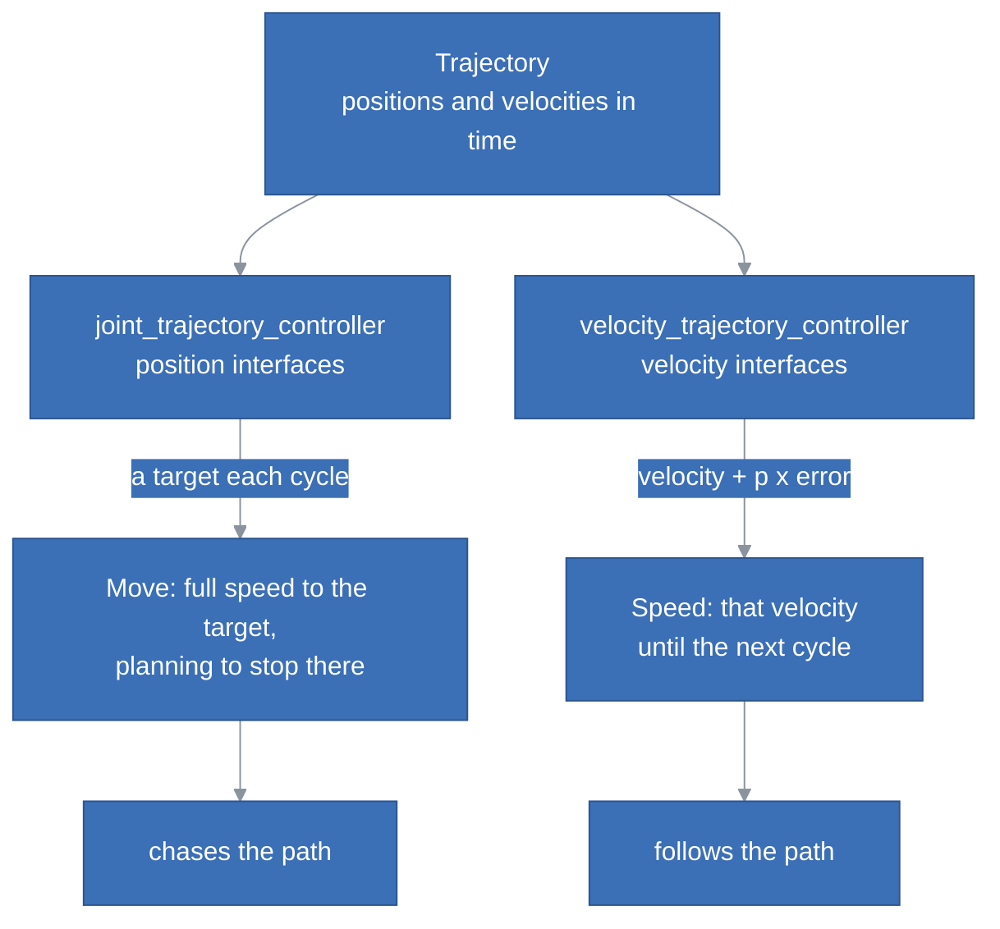

# Velocity Trajectory Controller

Branch `velocity-trajectory-controller`.

## Goal

A robot needs to follow a path in time, e.g. to draw an SVG or to move a camera smoothly, not only to reach a point. `joint_trajectory_controller` cannot: it strays from the path by hundreds of motor steps.

## Decisions

**A second trajectory controller, on the velocity interfaces.** `joint_trajectory_controller` sends positions, and the firmware runs each motor at full speed to each one and plans to stop there: the motors chase the trajectory. `velocity_trajectory_controller` sends the velocity of the trajectory plus a correction, and the motor turns at that velocity until the next cycle.

**It keeps the old one.** `joint_trajectory_controller` stays active by default and unchanged: its constraints were measured on the position interfaces. The new one is loaded inactive, like `position_controller` and `velocity_controller`.

**The gains: `ff_velocity_scale: 1` and `p: 20`.** Both default to 0, and the controller would send velocity 0. The feed-forward does almost all the work; `p` removes what is left, an error dying away in about 50 ms. `i` and `d` stay 0.

**100 Hz instead of 30 Hz.** At 30 Hz each velocity is held for 33 ms and the motors stray from the path; in a simulation of the firmware, `p: 20` at 30 Hz oscillates. The rate is the controller manager's, so it applies to every controller.

**The serial port holds 100 Hz as it is.** We measured it on the rig, a Raspberry Pi 5 with a Teensy 4.0: a cycle, one velocity command and one status query, takes 1.6 ms on average and 2.7 ms at most over a minute at 100 Hz, with no overruns. Sending each frame in one write instead of one byte at a time would make it 0.4 ms; it is not needed.

## Left Out

**Fixing the velocity ramp of the firmware.** When the commanded velocity rises while a motor accelerates, AccelStepper's `setMaxSpeed()` adds an increment of speed without a step: the motor accelerates 11 to 24% harder than configured, and up to 2.5 times near zero speed. On a planned trajectory it costs about one step, so it waits for a pull request of its own.

**Planning the trajectory.** The controller follows what it is given and never checks the motors' limits. A client must slow down for corners and curves itself.

## Open Items

- At rest, the controller keeps correcting an error smaller than a step, and the joint hunts by one step. The README says to deactivate the controller when the trajectory is done; a deadband in `StepitHardware` would remove it.
- In a simulation of the firmware, the lag of `joint_trajectory_controller` is 1.7 times what the rig measures. We have not found why.

## Tested

- On the rig, the same 7 s ellipse on the rotary stage and the rail: `joint_trajectory_controller` at 30 Hz trailed by up to 486 steps on the stage and 1,156 on the rail; `velocity_trajectory_controller` at 100 Hz by 1 and 3, as the simulation predicted.
- On the fake motors, the commands of the README in order: the new controller is loaded inactive, the controller manager runs at 100 Hz, and the example ends on its last waypoint, `joint1` at 15.71 rad and `joint2` at -3.14 rad.
- `bin/check-diagrams.sh` passes.
